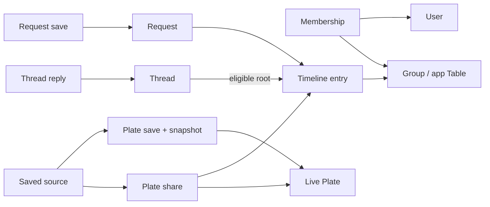

# Plates — Logical Data Model

Logical design draft · updated 2026-10-04

This describes records and their relationships, not an implemented schema. PostgreSQL through Supabase is now the selected direction; see [STACK.md](STACK.md). Record structure below is a technical proposal supporting [Product Model v1](PRODUCT_MODEL.md), updated after feedback on the original draft. `Table` means the app's private group; the proposed storage name is `groups` to avoid confusion.

## Three separate things

1. **Live Plate:** the author's contribution, which can change over time.
2. **Plate share:** one appearance of that Plate in one private Table, with its own sharer, introduction, and discussion.
3. **Menu save:** one person's captured reminder, linked to the live Plate and the particular share where they found it, if applicable.

Formal Requests add a distinct save behaviour: a personal reference to the ongoing Request thread, without copying its answers. Plate saves can retain several explicitly added source-share references.

Example: Alex publishes cornbread. Bea brings it to a Table. Chris saves it. Alex remains the author; Bea is the sharer; Chris owns the Menu item. Bea sharing it again creates a new discussion about the same Plate. Alex editing it changes the live Plate, while Chris's captured reminder remains.

## Proposed records

Each record has a stable identifier. References store another record's identifier rather than duplicating every related object. Creation/update times are included where needed.

| Record | Principal information | Purpose |
| --- | --- | --- |
| `users` | Identity, display name, profile image reference | Authorship, attribution, following and membership. Authentication details depend on the later stack choice. |
| `follows` | Follower and followed user | Feed/discovery relationship, independent of Plate viewing permission. Proposed: at most one active relationship for each pair. |
| `groups` | Table name, image, creator | Private conversation identity. Roles and ownership rules remain to be designed. |
| `group_memberships` | Group, user, membership state | Controls conversation, thread, media, and search access. Joining/history rules remain open. |
| `plates` | Author, category, content, optional tags, timestamps, availability | Current deliberately published contribution. Content accommodates text, links, and media; category multiplicity remains open. |
| `timeline_entries` | Group, author, entry kind, content, stable ordering key, timestamps, availability | Common main-conversation record for ordinary messages, Plate shares and formal Requests. |
| `plate_shares` | Unique timeline entry, Plate, revision number at sharing | Share-specific details; the entry supplies group, sharer and introduction. Repeat Plate/group combinations are valid. |
| `requests` | Unique timeline entry, question and supporting context | Formal Table Request. Feed distribution is deferred. |
| `threads` | Unique eligible root entry | Thread rooted at a Plate share or Request; derives its group/audience from the entry. No arbitrary-message thread creation. |
| `thread_replies` | Thread, author, content, timestamps, availability | One thread reference, avoiding parallel nullable share/Request references. No duplicate reply body in the main timeline. |
| `media_assets` and typed attachments | Storage reference, metadata and separate Plate/entry/reply/saved-preview relationships | Supabase Storage holds files; enforceable references connect records to media. Avoid unchecked generic owner-type/owner-ID pairs. |
| `menu_plate_saves` | Saver, live Plate reference, first-save time, captured representation | Unique saver/Plate. Snapshot does not refresh when adding another source. |
| `menu_plate_sources` | Plate save, source-share reference, time added | Unique save/share; the share must reference the same Plate. A feed save initially has no source-share child. |
| `menu_request_saves` | Saver, Request, saved time | Proposed unique saver/Request; opens the ongoing thread under current membership rules. Does not capture all replies. |

Categories and tags are concepts at this stage. Whether they require separate lookup records depends on the agreed taxonomy and later physical schema.

The proposed common timeline removes the need to merge separate message/share streams. Give each entry an immutable ordering key within its group, with a unique tie-breaker if needed, and use it for cursor pagination. A per-member last-read position can refer to this order later; unread behaviour is not yet implemented. Thread roots must be eligible entry types, with exactly the required matching share/Request detail record. Enforce these relationships transactionally in the physical schema. Ordinary messages do not acquire threads merely because the storage supports a shared root structure.

## Relationship sketch

An arrow means “references”; several records may reference the same destination. This deliberately omits field-level details, media attachments, follows and user attribution for readability.

## Saved fields and media — proposed minimum

Propose capturing category, displayed text/links/tags, author attribution, and one preview image where present, with the save timestamp. A text-only Plate gets a text reminder. This does not yet promise a full-resolution archive of every image or an archived copy of an external recipe website. Exact fields, limits, and preview resolution need owner review.

The snapshot is a deliberate exception to keeping one live copy: it preserves what was saved. It does not contain a copy of the Table conversation. Source children identify the group/sharer context and exact discussion. Direct feed saves initially have no source children; explicitly saving from a later discussion adds one without changing the reminder.

A retained preview must reference an asset that survives ordinary original removal. One immutable preview asset can serve several saves; the app need not copy the entire photograph for every saver. Retention rules must also survive Plate image replacement. Physical storage cleanup and deletion operations are outside this draft.

Ordinary unpublishing must not cascade into removing captured saves. Broader removal for account-deletion/intervention cases must be able to purge or blank affected snapshots, attribution and media, rather than merely hiding the original. Exact policy is still open. Track retained copies back to source identifiers so the operation can find them. A non-content tombstone may preserve navigation/timeline structure without preserving the removed body. A soft-delete flag alone is not erasure.

Repeat-save behaviour is agreed: unique saver/Plate, one captured reminder, multiple explicitly added source shares; repeated identical sources add nothing. Adding a source never silently refreshes the snapshot, and simply viewing a discussion does not add it. The interface distinguishes `Already in your Menu` from `Keep this discussion as another source`.

Existing Plate shares render current content and show `Edited since shared` when the live revision differs from the revision recorded at sharing. Increment revisions on relevant content edits. No historical copy is implied by a revision number; historical-version browsing is deferred.

## Access and retrieval

- No private author-profile flag or follower gate is needed for MVP Plate viewing. A signed-in first version is proposed; public logged-out browsing has not been decided.
- Group membership protects ordinary messages, share introductions, thread replies, Table media, and Table search. Knowing a Plate or share identifier does not grant membership.
- Menu saves belong to the saver. Their links do not override source access. On losing Table access, opening that discussion must not expose its contents; exact unavailable-source presentation and retained source labels remain open.
- Following an author does not reveal their Tables. Publishing/promoting one's own contribution does not expose the private source conversation to the new audience.
- Search can initially query the same accessible records and their existing text/tags. Author lookup joins the Plate to its author. No separate search engine is assumed.
- Table image browsing includes message images and images attached to Plates shared there, respecting group access. Whether repeat shares show repeated thumbnails is a presentation choice.

## Requests and promotion

Formal Table Requests and dedicated threads are now confirmed. The Request identifies its asker, question, supporting context and one Table destination through its root entry. A Menu save reopens that ongoing thread, including later answers, subject to current access. Feed Requests are deferred. No selected answer, mandatory resolution, or global answer aggregation is needed.

Requests appear as recognisable cards among ordinary conversation. Their replies use the same proposed thread/reply structure as Plate shares. Request replies do not imply that every ordinary message can start a thread.

Promotion starts an editable Plate draft from the author's own material. A private source reference can preserve provenance, but rendering that reference must respect membership. Draft persistence and source-link presentation remain interface/schema choices.

Individual-message saving has no record shape in this baseline. It can be designed later without treating every message as a Plate or thread root.

## Integrity and lifecycle requirements before connected use

- Enforce that a saved source belongs to the same Plate as its parent save, and that thread roots/replies share the correct Table audience.
- Reject new shares of unavailable Plates; perform availability checks with the write so concurrent removal cannot bypass them.
- Authorise private media delivery as well as records, search and realtime subscriptions. Guess-resistant URLs are not a permission boundary.
- Retained media needs explicit attachment/retention rules and eventual cleanup. A broader removal overrides ordinary saved-preview retention; expiry and cached/signed-URL behaviour need definition.
- Preserve timeline/root structure when entries are ordinarily removed; do not silently erase other people's replies. The exact UX for a removed share with replies, departed authors, deleted Tables and last-member departure remains to be settled before those operations are implemented.
- Blocking/reporting controls are deferred for the friends-only release, but central access checks, content identifiers and removal states must support later implementation. Shared-Table blocking semantics remain open.
- Follows can represent current relationships only, with unfollow removing that relationship; this is a technical proposal, not an approved deletion operation in the development environment.

## Scenarios checked against the draft

| Scenario | How the model represents it |
| --- | --- |
| Same Plate shared twice in one Table | Two share IDs, same Plate/group, separate reply sets. |
| Shared in two Tables | Same Plate, different shares/groups; each discussion has its own membership checks. |
| Saved from feed | Menu save with a Plate reference and no source share. |
| Saved from a Table thread | Menu save points to that exact share and preserves original author separately from sharer. |
| Same user saves from feed and then a Table | Same Plate save and original snapshot; one explicit source child added. |
| Save formal Request, then another member replies | Saved entry opens the current discussion with the later reply; no frozen answer copy. |
| Original later edited | Live record changes; captured representation remains. |
| Original ordinarily removed | Live source becomes unavailable; retained reminder/preview survives. Whether the existing discussion stays open remains a product choice. |
| Non-follower opens shared Plate | No follow gate; this reveals no private discussion by itself. |
| User leaves source Table | Discussion access is denied; precise source-label behaviour remains open. |
| Text/link contribution without photo | Valid Plate and saved reminder; no image is required. |
| Account deletion or removal for cause | Trace and remove affected retained content, assets and attribution according to the defined policy; exact handling remains open and must not be confused with unpublishing. |
| Sharer removes a share with replies | Preserve a structural root/tombstone; final reply visibility and controls remain open. |
| Source Table deleted | Request/source discussion becomes unavailable; ordinary Plate reminders survive subject to broader removal rules. Exact Table-deletion lifecycle remains open. |

These are design consistency checks, not executed software tests. Next, translate the first build slice into SQL and membership-policy tests after branch/setup approval. The stack is selected; remaining screens do not block the initial local foundation. Snapshot field limits and destructive lifecycle details still require review before their dependent operations are enabled.
