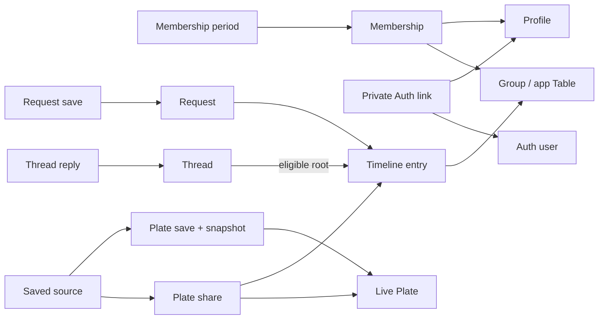

# Plates — Logical Data Model

Logical design draft · updated 2026-10-08

Implementation status: Owner-provided output confirms [M1 SQL](supabase/migrations/20261006000100_identity_membership.sql) was applied locally on 2026-10-06, after confirmation of `prototype-foundation`, and its [rollback-only acceptance tests](supabase/tests/identity_membership.sql) passed. Local Auth and the one-account connected Plate loop passed browser testing on 2026-10-08; populated owner/non-member HTTP and same-session concurrent retry checks passed. M1 creates identity/membership records, a signup trigger, own-name editing, Table creation and protected reads. Invitations and lifecycle endpoints remain disabled; later operations must follow the full lock plan. See [local database instructions](supabase/README.md). Later design sections describe the wider planned schema, not additional applied migrations.

M2 implementation status: Owner-provided output confirms [Plates/timeline SQL](supabase/migrations/20261006000200_plates_timeline.sql) applied locally on 2026-10-06 and its [acceptance tests](supabase/tests/plates_timeline.sql) passed on 2026-10-07 after a fixture-label correction. M1 regression against M2 also passed. M3 [Menu reminders SQL](supabase/migrations/20261007000100_menu_reminders.sql) and its [acceptance tests](supabase/tests/menu_reminders.sql) passed locally, followed by successful M1/M2 regression against M3. All suites rolled back fixtures. M2 supports text/links, rejects attachment IDs until M4, and uses deferred content checks ready for that later extension. It includes original retry fingerprints, controlled counters, independent share threads and author-only edits. Plate edits require an expected revision; entry/reply edits have no stale-edit version field. See the [runbook](supabase/README.md) for exact operations and URL parser limits.

M3 implementation status: Owner-provided CLI output confirms [Menu reminder SQL](supabase/migrations/20261007000100_menu_reminders.sql) applied locally on 2026-10-07 and its [acceptance tests](supabase/tests/menu_reminders.sql) passed, including M1/M2 regression against M3. Captured text/link content and labels are immutable; explicit source references resolve through current RLS. Media previews and removal operations remain disabled. Source additions require an available Plate; existing source-free repeat saves still return retained reminders after unpublish. The additive [author identity view](supabase/migrations/20261008000100_my_profile.sql) and its rollback-only suite passed locally on 2026-10-08, enabling the author-only edit control without exposing the private Auth link. See the runbook for first-save revision conflicts, locking and remaining different-member concurrency limits.

This describes the wider intended records and their relationships; only the implementation status above establishes which parts exist. PostgreSQL through Supabase is now the selected direction; see [STACK.md](STACK.md). Record structure below is a technical proposal supporting [Product Model v1](PRODUCT_MODEL.md), updated after feedback on the original draft. `Table` means the app's private group; the proposed storage name is `groups` to avoid confusion.

## Three separate things

1. **Live Plate:** the author's contribution, which can change over time.
2. **Plate share:** one appearance of that Plate in one private Table, with its own sharer, introduction, and discussion.
3. **Menu save:** one person's captured reminder, linked to the live Plate and the particular share where they found it, if applicable.

Formal Requests add a distinct save behaviour: a personal reference to the ongoing Request thread, without copying its answers. Plate saves can retain several explicitly added source-share references.

Example: Alex publishes cornbread. Bea brings it to a Table. Chris saves it. Alex remains the author; Bea is the sharer; Chris owns the Menu item. Bea sharing it again creates a new discussion about the same Plate. Alex editing it changes the live Plate, while Chris's captured reminder remains.

## Record responsibilities

Profiles supply app identity; Supabase Auth owns login credentials. Groups and memberships determine private Table access. Plates hold current published content. A shared Plate gets a timeline entry, share details and its own thread; replies belong to that thread. Menu saves hold captured Plate reminders with explicitly kept discussion sources. Requests later add live-discussion saves, while follows affect discovery rather than Plate viewing permission.

The common timeline interleaves ordinary messages, shares and later Requests. Typed media attachments connect assets to their permitted uses, including avatars, Table images and retained previews. A message does not become a thread root just because it appears in the same timeline.

The **Records and key fields** table below is the single schema reference, including foreign-key deletion behaviour and named later extensions. The surrounding sections explain behaviour; they do not define a second set of columns. Unsettled product choices and their implementation blockers are consolidated in the final decisions table.

## Relationship sketch

An arrow means “references”; several records may reference the same destination. This deliberately omits field-level details, media attachments, follows and user attribution for readability.

## Saved fields and media — agreed reminder

Capture category, displayed text/links/tags, author attribution, and one per-save preview image where present, with the save timestamp and Plate revision. A text-only Plate gets a text reminder. The author's displayed name is frozen at save time: later renames do not update Menu reminders. Erasure overrides this retention. This is not a full-resolution archive of every image or an archived copy of an external recipe website. D1 and the initial D4 limits were settled in the October 5 feedback, recorded October 6.

The snapshot is a deliberate exception to keeping one live copy: it preserves what was saved. It does not contain a copy of the Table conversation. Source children identify the group/sharer context and exact discussion. Direct feed saves initially have no source children; explicitly saving from a later discussion adds one without changing the reminder.

A retained preview references a generated thumbnail in private storage, with lineage to its original asset. It does not reference the original upload as its preview. Use one immutable thumbnail asset per Menu save rather than sharing a thumbnail across savers: the extra small objects buy a simpler ownership rule. It must survive ordinary Plate removal or image replacement. Broader erasure still traces all derivatives and retained saves. Physical storage cleanup and deletion operations are outside this draft.

Ordinary unpublishing must not cascade into removing captured saves. The adopted erasure default is “erased means blank”: account/intervention erasure clears the affected author's content, saved copies, attribution and derived media, leaving only non-content structural stubs where needed. Track retained copies back to source identifiers so the operation can find them. Other people's independent replies are not automatically erased. The operation, physical assets, backups, caches and any exceptions need design, tests and appropriate advice before real-user invitations. A soft-delete flag alone is not erasure; adopting the policy does not authorise executing deletion.

Repeat-save behaviour is agreed: unique saver/Plate, one captured reminder, multiple explicitly added source shares; repeated identical sources add nothing. Adding a source never silently refreshes the snapshot, and simply viewing a discussion does not add it. The interface distinguishes `Already in your Menu` from `Keep this discussion as another source`.

Existing Plate shares render current content and show `Edited since shared` when the live revision differs from the revision recorded at sharing. Increment revisions on body/link/tag/category edits and every media attach, detach, reorder or replacement, including publishing a newly ready image into the Plate. Original and derived image bytes are immutable; replacement uses a new asset. No historical copy is implied by a revision number; historical-version browsing is deferred.

## Access and retrieval

- No private author-profile flag or follower gate is needed for MVP Plate viewing. Connected use is signed-in only; no logged-out browsing in the friends-only release.
- Group membership protects ordinary messages, share introductions, thread replies, Table media, and Table search. Knowing a Plate or share identifier does not grant membership.
- Active members can read full earlier Table history. Only owners invite initially; the invite interface must say “New members can see earlier conversation.”
- Menu saves belong to the saver. Their links do not override source access. Former members retain Plate reminders with an unavailable-source indication, but no resolved Table name, sharer details, introduction or discussion content.
- Following an author does not reveal their Tables. Publishing/promoting one's own contribution does not expose the private source conversation to the new audience.
- Search can initially query the same accessible records and their existing text/tags. Author lookup joins the Plate to its author. No separate search engine is assumed.
- Table image browsing includes message images and images attached to Plates shared there, respecting group access. Whether repeat shares show repeated thumbnails is a presentation choice.

## Requests and promotion

Formal Table Requests and dedicated threads are now confirmed. The Request identifies its asker, question, supporting context and one Table destination through its root entry. A Menu save reopens that ongoing thread, including later answers, subject to current access. Feed Requests are deferred. No selected answer, mandatory resolution, or global answer aggregation is needed.

Requests appear as recognisable cards among ordinary conversation. Their replies use the same proposed thread/reply structure as Plate shares. Request replies do not imply that every ordinary message can start a thread.

Promotion starts an editable Plate draft from the author's own material. A private source reference can preserve provenance, but rendering that reference must respect membership. Draft persistence and source-link presentation remain interface/schema choices.

Individual-message saving has no record shape in this baseline. It can be designed later without treating every message as a Plate or thread root.

## Integrity and lifecycle requirements before connected use

- Enforce that a saved source belongs to the same Plate as its parent save, and that thread roots/replies share the correct Table audience.
- Reject new shares of unavailable Plates; perform availability checks with the write so concurrent removal cannot bypass them.
- Authorise private media delivery as well as records, search and realtime subscriptions. Guess-resistant URLs are not a permission boundary.
- Retained media follows D4 limits below. Erasure overrides ordinary saved-preview retention; physical cleanup and cache handling must be tested before enabling erasure.
- Invite-only joining, initially by owners. Members can leave; past messages use “former member” attribution within that Table. This does not rename their global profile or rewrite frozen Plate reminder names. The last owner must transfer ownership before leaving; membership transitions enforce this under the exclusive group guard.
- Unpublishing a Plate leaves its shares as “no longer available” and existing replies visible to active members. Preserve root structure rather than silently erasing other people's replies. Detailed individual-share removal controls remain to be designed.
- Savers may unsave their own reminders or remove one saved source. No Table deletion in the first release; only archiving. Archive write/read semantics and the transition operation still require specification before implementation. These lifecycle defaults do not enable removal endpoints.
- Blocking/reporting controls are deferred for the friends-only release, but central access checks, content identifiers and removal states must support later implementation. Shared-Table blocking semantics remain open.
- Follows can represent current relationships only, with unfollow removing that relationship; this is a technical proposal, not an approved deletion operation in the development environment.

## Scenarios checked against the draft

| Scenario | How the model represents it |
| --- | --- |
| Same Plate shared twice in one Table | Two share IDs, same Plate/group, separate reply sets. |
| Shared in two Tables | Same Plate, different shares/groups; each discussion has its own membership checks. |
| Saved from feed | Menu save with a Plate reference and no source share. |
| Saved from a Table thread | Menu save points to that exact share and preserves original author separately from sharer. |
| Same user saves from feed and then a Table | Same Plate save and original snapshot; one explicit source child added. |
| Save formal Request, then another member replies | Saved entry opens the current discussion with the later reply; no frozen answer copy. |
| Original later edited | Live record changes; captured representation remains. |
| Original ordinarily removed | Shares show “no longer available”; retained reminder/preview survives and existing replies remain visible to active members. |
| Non-follower opens shared Plate | No follow gate; this reveals no private discussion by itself. |
| User leaves source Table | Discussion access and resolved source labels/context are denied; Plate reminders remain. Past Table messages use “former member” attribution. |
| User leaves and later rejoins a Table | Close the old membership period and append a new one; retain the current left/removed/active state. Visibility follows decision D3 rather than an overwritten join time. |
| Text/link contribution without photo | Valid Plate and saved reminder; no image is required. |
| Account/intervention erasure | Blank affected author content, saved copies, attribution and media; retain non-content stubs. Full operation and backup/cache handling must be designed before real users. |
| Sharer removes a share with replies | Preserve a structural root/tombstone; final reply visibility and controls remain open. |
| Source Table archived | Archiving is the first-release lifecycle direction; no Table deletion. Exact archive access/write semantics remain an implementation prerequisite. |

These are design consistency checks, not executed software tests. Local database setup is complete as recorded in STACK.md; next translate the first build slice into SQL and membership-policy tests after branch confirmation. Remaining screens do not block the foundation. Detailed lifecycle operations still require design before they are enabled.

## First database slice — review draft, 2026-10-05

The local navigation shell works according to the owner, who reconfirmed `prototype-foundation` on October 5. The schema and transaction mechanics remain a design draft, not applied migrations. Product decisions subsequently settled in D1–D9 are recorded below; they do not mean the implementation exists.

### Records and key fields

Use UUID identifiers and timezone-aware timestamps. An `id` column is the primary key unless another primary key is explicitly stated. FK components are NOT NULL except those explicitly marked nullable, so composite checks cannot be bypassed through null components. `user_id`, `author_id`, `saver_id` and similar app-actor references point to `profiles.id`, not directly to Auth. Foreign keys verify that references exist; unique constraints prevent duplicate combinations. Records have `created_at` and, where mutable, `updated_at`; positions and first-save times are immutable.

The `ON DELETE` column describes a database constraint, **not permission to delete data**. The proposal uses `RESTRICT` for every listed foreign key: parent records cannot be hard-deleted while references remain. IDs/root relationships are immutable (`ON UPDATE RESTRICT`). No cascading deletion or automatic blanking is assumed. Nullability only permits an explicit authorised workflow to clear an attribution/auth link; it does not happen on parent deletion. PostgreSQL distinguishes these behaviours in its [constraint documentation](https://www.postgresql.org/docs/current/ddl-constraints.html).

| Record | Proposed key fields | Keys and responsibility | ON DELETE for foreign keys |
| --- | --- | --- | --- |
| `profiles` | `id`, `display_name`, `state` | Stable app ID with no Auth identifier column. An active profile requires exactly one private Auth link; erased profiles have none. Display name is plain text, required while active. | None; no outbound FK |
| `private.profile_auth_links` | `profile_id`, unique `auth_user_id` | Primary key `profile_id`; both references NOT NULL. Not an exposed API table; no client read/write grants. Only narrowly scoped identity/signup/erasure functions access it. Disabled profiles may retain a link. | Profile and `auth.users.id`: RESTRICT |
| `categories` | `id`, unique `slug`, `label` | Required single Meal/Recipe/Place choice; definitions below. Saved labels are captured independently. | None; no outbound FK |
| `groups` | `id`, `name`, nullable `created_by`, `availability`, `next_entry_position` | App Table; create with owner membership. Counter starts at 1 and is writable only through controlled operations. Creator may be cleared only during erasure. | Creator → profile: RESTRICT |
| `group_memberships` | `group_id`, `user_id`, `role`, `state` | Primary key `(group_id, user_id)`; retain state to distinguish active/left/removed. Deferred triggers enforce consistency with periods; both change in one group-guarded transaction. | Group and profile: RESTRICT |
| `membership_periods` | `id`, `group_id`, `user_id`, `joined_at`, nullable `ended_at`, nullable `end_reason` | Composite FK to membership; at most one open period per group/user using a partial unique index. Rejoining appends a period. Deferred checks reject overlapping periods, invalid time ranges and disagreement with current state. | `(group_id, user_id) → group_memberships`: RESTRICT |
| `plates` | `id`, nullable `author_id`, nullable `category_id`, `body`, `links`, `tags`, `revision`, `availability` | Available Plate requires author, category and content (text, link or media). Positive server-owned revision increments on displayed edits. Erased tombstone permits cleared content/attribution while retaining `id`. | Author and category: RESTRICT |
| `timeline_entries` | `id`, `group_id`, nullable `author_id`, `kind`, `body`, `links`, `position`, `availability`, `client_request_id`, nullable `request_fingerprint` | Unique `(group_id, position)`, `(author_id, group_id, client_request_id)`, `(id, kind)`, `(id, group_id, kind)`. Available entry requires author and fingerprint; required UUID request ID is immutable. Fingerprint derives from canonical input and is immutable except for explicit erasure. | Group and author: RESTRICT |
| `plate_shares` | `entry_id`, `kind`, `plate_id`, `plate_revision_at_share` | Primary key `entry_id`; `CHECK (kind = 'plate_share')`; composite FK `(entry_id, kind) → timeline_entries(id, kind)`; unique `(entry_id, plate_id)` is the saved-source FK target. Positive revision at share; repeat Plate/group pairs allowed. | Entry composite and Plate: RESTRICT |
| `threads` | `id`, `root_entry_id`, `group_id`, `root_kind`, `next_reply_position` | Unique root entry; unique `(id, group_id)`. Composite FK `(root_entry_id, group_id, root_kind) → timeline_entries(id, group_id, kind)`. First slice permits `root_kind = 'plate_share'`; Request migration later adds `request`. Owns the reply counter, starting at 1. | Root composite: RESTRICT |
| `thread_replies` | `id`, `thread_id`, `group_id`, nullable `author_id`, `body`, `links`, `position`, `availability`, `client_request_id`, nullable `request_fingerprint` | Composite FK `(thread_id, group_id) → threads(id, group_id)`; unique `(thread_id, position)` and `(author_id, thread_id, client_request_id)`. Available reply requires author, fingerprint and text/link/media. Required UUID retry ID is immutable; fingerprint clears only for erasure. | Thread composite and author: RESTRICT |
| `menu_plate_saves` | `id`, `saver_id`, `plate_id`, `saved_at`, `snapshot_revision`, `availability`, `snapshot_body`, `snapshot_links`, `snapshot_tags`, nullable `snapshot_category_id`, `snapshot_category_label`, nullable `original_author_id`, `snapshot_author_name` | Unique `(saver_id, plate_id)` and `(id, plate_id)`. Available reminder requires category, original author and their captured labels; body may be empty for image/link content. Nullable attribution/category FKs permit explicit erasure. Snapshot columns are defined here; normal saves cannot refresh them. | Saver, Plate, snapshot category and original author: RESTRICT |
| `menu_plate_sources` | `save_id`, `share_entry_id`, `plate_id`, `added_at` | Primary key `(save_id, share_entry_id)`; FKs `(save_id, plate_id) → menu_plate_saves(id, plate_id)` and `(share_entry_id, plate_id) → plate_shares(entry_id, plate_id)` enforce the same Plate. | Both composites: RESTRICT |
| `media_assets` | `id`, nullable `uploaded_by`, `bucket_id`, `object_path`, `media_type`, `width`, `height`, `state`, nullable `derived_from_asset_id`, nullable `scope_group_id`, nullable `scope_profile_id` | Unique storage location while present. Bucket class and scope identify the allowed audience; rules below constrain combinations. Immutable lineage points to an existing asset; no self-reference, cycles or reparenting. Bytes, location and audience cannot change in place. Erasure may blank metadata while retaining IDs. | Uploader, source asset, scope group and scope profile: RESTRICT |
| `plate_media` | `plate_id`, `asset_id`, `position` | Primary key `(plate_id, asset_id)`; unique `(plate_id, position)`; only authorised ready media may attach. | Plate and asset: RESTRICT |
| `entry_media` | `entry_id`, `asset_id`, `position` | Primary key `(entry_id, asset_id)`; unique `(entry_id, position)`; inherits Table audience. | Entry and asset: RESTRICT |
| `reply_media` | `reply_id`, `asset_id`, `position` | Primary key `(reply_id, asset_id)`; unique `(reply_id, position)`; inherits reply audience. | Reply and asset: RESTRICT |
| `profile_avatars` | `profile_id`, `asset_id` | Primary key `profile_id`; at most one current avatar; signed-in profile audience. | Profile and asset: RESTRICT |
| `group_images` | `group_id`, `asset_id` | Primary key `group_id`; at most one current Table image; members-only audience. | Group and asset: RESTRICT |
| `menu_plate_preview` | `save_id`, unique `asset_id` | Primary key `save_id`; one derived thumbnail asset/object per save. Bucket must be `menu-previews`, scope profile must equal the saver, and lineage must match the first ready Plate image under the snapshot revision lock. | Save and derived asset: RESTRICT |
| `follows` (later feed migration) | `follower_id`, `followed_id`, `created_at` | Primary key `(follower_id, followed_id)`; `CHECK (follower_id <> followed_id)`. Current relationships only, no active/inactive state; unfollow will explicitly remove the relationship once that operation is authorised. | Both profiles: RESTRICT |
| `requests` (later Request migration) | `entry_id`, `kind`, `question` | Primary key `entry_id`; `CHECK (kind = 'request')`; FK `(entry_id, kind) → timeline_entries(id, kind)`. Supporting context/availability live on the root entry. | Entry composite: RESTRICT |
| `menu_request_saves` (later Request migration) | `id`, `saver_id`, `request_entry_id`, `saved_at` | Unique `(saver_id, request_entry_id)`; live discussion reference, with no copied answers. | Saver and Request: RESTRICT |

**Explicit state values:** profiles: `active`, `disabled`, `erased`; groups, Plates, timeline entries and replies: `available`, `removed`, `erased`; Menu Plate saves: `available`, `erased`; memberships: `active`, `left`, `removed`; membership roles: `owner`, `member`; period `end_reason`: null while open, otherwise `left`, `removed` or `erased`; assets: `staged`, `ready`, `erased`. Timeline `kind`: `message`, `plate_share` in the first slice; `request` is added by the later migration. Invitations are separate future records, never active memberships. States define valid representations, not permission to enable every transition now.

`removed` means unavailable through ordinary product removal; `erased` requires content/attribution blanking and the broader workflow. An available message/reply must have content; share introductions may be empty. Erased rows cannot retain body, links, tags or identifying labels. Preserve the Plate/root IDs and constrained source relationships; do not hard-delete a Plate to erase its body. Ordinary removal leaves captured saves; broader erasure explicitly clears affected snapshots, attribution and physical media. Stable IDs and a flag alone do not establish complete erasure, and backups/caches require their own handling.

Auth deletion is deliberately restricted until the erasure workflow has cleared the private Auth-link record and dealt with the app profile/content. That future transaction disables/erases the profile consistently with removing its link; no live deletion is authorised here. Retaining a stable app profile ID avoids breaking references, but an erased profile cannot retain identifying content. Private link administration is not a client capability. Similarly, group deletion and last-owner departure are not enabled just because tombstone states exist.

**Subtype completeness:** composite FKs and discriminator checks prevent the wrong detail kind. They cannot force every root to have a detail. Add deferred constraint triggers on root/detail/thread insert/update/delete to validate final transaction state: every share root has exactly its share detail and one thread; ordinary messages have neither; later Request roots have exactly their Request detail and one thread. Revalidate both old and new roots on attempted reparenting, or reject reparenting entirely as proposed here. Retain structural detail/thread rows when content is tombstoned. See PostgreSQL's [constraint-trigger documentation](https://www.postgresql.org/docs/current/sql-createtrigger.html).

**Other cross-record invariants:** ordinary CHECK constraints cover only a row's own fields. Add the following database trigger coverage alongside subtype completeness. Controlled writes take the common parent/guard lock before mutation, so concurrent transactions cannot each validate an incomplete view of the other. Deferred checks validate the final transaction state and permit an image replacement to temporarily remove an attachment before adding its replacement.

| Invariant | Trigger coverage | Required final state / guard |
| --- | --- | --- |
| Available content is non-empty | Plate, ordinary-message entry and reply insert/update; their attachment insert/update/delete; attached asset state changes | Trimmed non-empty body, a valid link or at least one ready permitted media attachment. Lock the Plate, or group-guarded entry, or thread-guarded reply before changing it. Removing the last image from image-only content fails unless valid replacement content or an authorised lifecycle transition is in the same transaction. |
| Membership state agrees with periods | Membership and period insert/update/delete | Active means exactly one open period; left/removed means none. Reject overlapping/invalid periods and require ended time/reason together. Every transition obtains the exclusive group guard first. Keep state for the left-versus-removed distinction, with deferred consistency rather than two independently writable facts. |
| Profile state agrees with private identity link | Profile and private Auth-link insert/update/delete | Active means exactly one link; disabled permits zero or one; erased means no link. Signup creates both records in one transaction. Existing-profile/link changes take that profile's exclusive guard. |
| Attachment has the right audience and ready asset | Before attaching/repointing any typed attachment, validate bucket and scope; deferred checks cover affected parents and asset state changes | Enforce the bucket/scope matrix below. Audience/location/lineage are immutable; changing audience requires a distinct authorised object. Reject Table-only assets used as avatars or Plate images, including crafted direct requests. |
| Menu preview belongs to the captured Plate version and saver | First-save operation under the Plate lock, plus deferred checks on save/preview and referenced asset changes | At capture, verify source choice/revision as specified below. Thereafter enforce one asset per save, saver scope, ready state while readable, and immutable lineage; do not compare retained snapshots to the later live Plate. Erasure changes both save visibility and affected assets consistently. |

**Bucket and attachment matrix:** these are proposed private bucket identifiers, not created buckets. A bucket class narrows the use; scope fields prevent crossing between two Tables or two people within that class. CHECKs validate each asset's scope/nullability pattern; attachment triggers compare it to the destination.

| Private bucket | Permitted destination | Required asset scope |
| --- | --- | --- |
| `staged-assets` | No published attachment | Uploader only; scope group/profile null. Promotion creates a new validated destination object rather than changing a staged object's audience in place. |
| `plate-media` | `plate_media` | Scope group/profile null; explicit published-Plate use, with attachment ownership checked. |
| `table-media` | `entry_media` or `reply_media` | `scope_group_id` equals the destination Table; scope profile null. |
| `avatars` | `profile_avatars` | `scope_profile_id` equals the destination profile; scope group null. |
| `table-images` | `group_images` | `scope_group_id` equals the destination Table; scope profile null. |
| `menu-previews` | `menu_plate_preview` | `scope_profile_id` equals the save's saver; scope group null; generated derivative with non-null lineage and unique use by one save. |

Separate objects may retain lineage to the same source, but bucket/scope validation never grants permission to copy that source. The approved upload/promotion operation must authorise source access and reuse first. Table-to-Plate promotion is still D9. Bucket, path, source lineage and scope are server-controlled; no client metadata claim establishes an audience. Asset state changes that affect attachments acquire their parent guards before asset locks and run the relevant deferred checks; multi-parent erasure remains disabled pending its M6 lock plan.

**Membership history:** keep current membership and append-only periods from the first slice. Active members, including rejoining members, see full earlier history under D3. A later since-joining rule requires a policy migration and explicit treatment of old roots with new replies, media, source links and read cursors. Periods preserve history rather than independently granting read access. Period access is restricted to the subject and authorised membership administration.

**Input rules:** agreed initial bounds are 20,000 characters for Plate/message/reply body, 10 links of at most 2,048 characters each, 10 tags of at most 40 characters after normalisation, and a trimmed display name of 1–80 characters. Parse absolute links and allow only `http:`/`https:` with a host; reject controls, embedded credentials, other schemes and overlong input. Store plain text and render it escaped, not as trusted HTML. Apply the same rules through controlled database operations. Normalise tags by trimming/collapsing whitespace, Unicode NFC and lowercasing, then deduplicate; apply the same normalisation to search input. Do not fetch supplied links as part of this slice.

**Categories:** require exactly one of Meal (what you ate), Recipe (how to make it), or Place (where to go); optional tags carry overlap. The owner's requested Meal-to-Recipe direction is a second published Plate with its own category, content, shares and discussions, leaving the Meal and its saves intact. A dedicated shortcut or cross-link remains a UI proposal; it does not require a new record type or copying other people's replies.

**Media defaults (D4):** accept JPEG, PNG and WebP, with HEIC converted on upload; maximum upload 10 MB (implementation convention: 10,000,000 bytes), up to six images per Plate and four per message/reply. Resize served images to at most about 2,048 px on the long edge and previews to about 640 px, without upscaling. Apply orientation before stripping EXIF from all served images, including previews. Validate actual file content, dimensions and successful processing before marking an asset ready. HEIC support remains unimplemented; codec/dependency selection needs separate review.

Unattached uploads become cleanup candidates after 24 hours; recheck attachment/retention references under the relevant locks before removal. No cleanup job or deletion is enabled by this policy. Signed URLs last about one hour and are regenerated on view after a fresh access check; issued URLs may remain usable until expiry, and downloaded copies cannot be recalled. Previews remain saver-only under the existing per-save ownership rule.

Following, Request operations, search and image browsing follow the first sharing/save loop. The named later rows above specify their current proposal without making them prerequisites for the first migration. This does not reduce the MVP boundary.

### What the saved reminder contains

All snapshot columns are defined in the `menu_plate_saves` row of the schema table. They retain the body, links, normalised tags, category and author labels/IDs, Plate revision and first-save time. The author avatar is not copied. At most one retained preview is linked through `menu_plate_preview`; text/link-only reminders remain valid. This is not an archive of every image or the destination of an external recipe link.

The application captures fields from authorised stored content, not a client-supplied author or snapshot. The proposed API is `save_plate(plate_id, expected_revision, optional_source_share_id, optional_preview_asset_id)`. The client supplies the Plate revision it displayed and, when there is an image, an asset ID returned by trusted preview preparation. Both are assertions for the server to check, not authority to copy content. A changed first-save revision produces a conflict and asks the user to refresh, as agreed in D1. Repeated saves retain the original captured author name and other fields.

**Preview selection and preparation:** select the lowest-position ready image on the Plate, with readiness/media type validated by the database and trusted upload processing. A text/link-only Plate has no preview source. Media attach/detach/reorder/replacement increments Plate revision in the same transaction, and an attached ready asset cannot silently change its bytes or readiness without its parent guard and integrity checks. Prepare a distinct thumbnail object for this saver before the first-save transaction, binding its asset record to `menu-previews`, this saver's scope and the exact source asset. It is inaccessible to ordinary clients until a matching Menu save/preview link commits; unused candidate objects stay inaccessible pending separately authorised cleanup.

Under the first-save Plate `FOR SHARE` lock, recheck `expected_revision`, read the current lowest-position ready image, and verify that the candidate is a trusted ready derivative with `derived_from_asset_id` equal to that source, the correct bucket/saver scope and no existing save attachment. Lock the source/candidate asset rows before final capture. Do not choose a different prepared thumbnail or regenerate it inside that transaction. Missing/not-ready candidates yield a preparation-required response; source/revision mismatch requires refreshed preparation, leaving no partial save. If no image source exists, require no preview candidate. A concurrent first-save loser returns the winning reminder and cannot replace its preview with its own candidate. Later Plate edits never trigger this source comparison for an already retained preview.

Table name, sharer and discussion are reached through the explicitly saved source reference. They are not copied into the Plate snapshot. Under approved D3, retain the Plate reminder and an unavailable-source indication, but stop returning the Table name, introduction, sharer details and replies when membership no longer permits access.

### Access rules to implement and test

Connected features require sign-in under D3. The existing local preview remains a credential-free shell. Row-level security means the database checks access for each record; hiding an interface control alone is insufficient.

| Record or content | Proposed read access | Proposed write access |
| --- | --- | --- |
| Available Plate and its published media | Signed-in users, regardless of following | Author through validated publishing/editing operations; no author/ID reassignment |
| Minimal app profile and category labels | Signed-in users | Own allowed profile fields; category list maintained through reviewed setup |
| Profile avatar | Signed-in users while the profile/asset is available | Profile owner attaches authorised media; no implicit access to the original private upload |
| Table image | Active Table members only | Authorised Table administration attaches permitted media |
| Table, membership list, timeline, share introduction, thread and replies | Active members of that Table | Active members may contribute as themselves; membership administration follows the approved owner/invitation rules |
| Membership periods | Subject and authorised Table administration | Controlled join/leave transitions only; no direct member rewriting of history |
| Menu Plate reminder and preview | Saver only | Save operation derives the saver from the signed-in identity and captures permitted Plate content |
| Saved discussion source | Saver owns the reference; current source membership controls resolved context | Saver explicitly adds an accessible source for that same Plate; reading a thread never adds it |
| Unattached media asset | Uploader through authorised upload handling | Uploader only until an approved attachment operation establishes another permitted use |

Prepared `menu-previews` are the exception to the unattached-upload read rule: clients cannot fetch them until their matching Menu link commits. Original uploads and derivative preparation stay distinct.

Media access must follow each attachment's authorised purpose. A retained preview can remain readable to its saver after ordinary Plate removal; that must not grant access to other images or the former Table conversation. Do not return private source-object paths or internal ancestry metadata with a readable derived thumbnail. Table-only images cannot become publicly readable just because their object identifier is known. Search and live updates must enforce the same rules when added.

New shares require an available Plate and current destination membership. A non-member must not learn a Table's content, member list or reply counts by guessing an identifier. Menu ownership must also be enforced for direct database/API access, not just for the Menu screen.

**Row and column boundaries:** RLS filters rows, not columns. Keep `private.profile_auth_links` outside exposed API schemas with no table privileges for `anon`, `authenticated` or `PUBLIC`. Only narrowly scoped helpers/trigger functions can resolve a caller's profile from `(select auth.uid())`; no helper returns arbitrary users' Auth mappings. Grant only the schema usage/function execution needed for those helpers, not private-table SELECT.

Revoke broad SELECT on metadata-bearing base tables from client roles and inherited/default client grants before allowing specific columns. Granting a safe column list does not narrow an existing whole-table SELECT. Define the read allowlists below explicitly in the migration; all client base-table INSERT/UPDATE/DELETE privileges remain denied in favour of controlled operations. Server-generated mutation responses must use the same safe projection rather than `RETURNING *`. See [PostgreSQL column privileges](https://www.postgresql.org/docs/current/sql-grant.html).

| Base record | Client-readable columns, still subject to RLS | Internal columns excluded from client SELECT |
| --- | --- | --- |
| `profiles` | `id`, `display_name`, `created_at`, `updated_at` | `state`; Auth ID is not present on this record at all |
| `timeline_entries` | `id`, `group_id`, `author_id`, `kind`, `body`, `links`, `position`, `availability`, `created_at`, `updated_at` | `client_request_id`, `request_fingerprint` |
| `thread_replies` | `id`, `thread_id`, `group_id`, `author_id`, `body`, `links`, `position`, `availability`, `created_at`, `updated_at` | `client_request_id`, `request_fingerprint` |
| `groups` | `id`, `name`, `created_by`, `availability`, `created_at`, `updated_at` | `next_entry_position` |
| `threads` | `id`, `root_entry_id`, `group_id`, `root_kind`, `created_at`, `updated_at` | `next_reply_position` |
| `media_assets` | `id`, `media_type`, `width`, `height`, only when the current use is authorised | Bucket/path, uploader, state, lineage and scope metadata; use a purpose-specific authorised delivery operation |

If a read view is introduced, enumerate its safe columns and set `security_invoker = true`, so underlying RLS and column privileges are evaluated for the caller. The projection references only allowed columns; internal state-based visibility checks stay in RLS rather than requiring extra client SELECT grants. A view is not a substitute for removing unsafe base-table grants. Test both view and base-table reads; confirm PostgreSQL version support during D8 before using this view option. Do not expose owner-rights views as a shortcut around RLS. [PostgreSQL view security](https://www.postgresql.org/docs/current/sql-createview.html).

**Policy implementation:** do not make the membership policy query itself through an ordinary invoker query. Use a narrowly scoped `private.is_active_member(group_id)` security-definer helper whose owner can read membership and private Auth links without recursive RLS. Pin `search_path = ''`, schema-qualify references, deny public execution and grant only necessary roles. It resolves the caller through `(select auth.uid())`, `private.profile_auth_links` and an active profile, accepting no arbitrary user ID. Keep the helper outside exposed API schemas and test its actual owner/RLS configuration; `SECURITY DEFINER` alone is not a guarantee of bypass. Group-dependent results are not statement-wide constants; the scalar `(select auth.uid())` optimisation does not make membership checks independent of the group. Use equally narrow identity and owner-administration helpers. See [Supabase RLS guidance](https://supabase.com/docs/guides/database/postgres/row-level-security) and [PostgreSQL function security](https://www.postgresql.org/docs/current/sql-createfunction.html).

Apply RLS and least-privilege grants to every exposed record. Controlled mutations must enforce actor, fields, state, membership and attachment rules even if implemented through privileged internal functions. Do not give clients arbitrary direct writes around these operations. Keep the service-role/secret key out of browser code, `NEXT_PUBLIC_*`, client-reachable configuration and ordinary user request handlers; a normal server route is not justification to bypass user permissions.

**Storage and Realtime:** all media buckets in this proposal are private. Authorise `storage.objects` operations through the specific valid attachment/use, not path secrecy or upload ownership alone. A profile avatar is signed-in content; a Table image is member-only; a retained Menu thumbnail is saver-only. Enforce the bucket/scope matrix in the database as well as in Storage policy helpers. Each thumbnail object belongs to one save, and read access requires the linked save's owner; knowing the owner's path prefix is not sufficient. Generated thumbnails have immutable `derived_from_asset_id` lineage; only trusted processing creates them, strips unnecessary metadata and marks them ready. Prepare derivatives before the save transaction, then revalidate lineage under its locks. Erasure must traverse all per-save derivatives; signed-URL expiry/cache handling remains D4/D6. [Storage policy reference](https://supabase.com/docs/guides/storage/security/access-control).

Postgres Changes uses source-record RLS checks for readable changes, with special limitations around delete events; it is not accurate to say all Realtime ignores record policies. Broadcast/Presence uses channel authorisation on `realtime.messages`, with access cached for a connection. Neither is assumed safe without integration tests. Keep content broadcasting disabled until active-subscription membership revocation and event payloads are tested; no client-side unsubscribe is treated as a security boundary. The transport choice and revocation mechanism are D7. [Postgres Changes](https://supabase.com/docs/guides/realtime/postgres-changes), [Realtime channel authorisation](https://supabase.com/docs/guides/realtime/authorization).

Do not publish raw metadata-bearing base rows to clients. The chosen Realtime path must prove a safe payload allowlist that excludes Auth links, request IDs/fingerprints and internal media metadata; do not assume column SELECT grants automatically filter every event payload. Until that is demonstrated, connected reads use the authorised API projection and Realtime remains disabled.

### Operations that must succeed together

These are transaction requirements: each operation either completes fully or leaves none of its partial writes behind.

1. **Create the app profile at signup:** use an AFTER INSERT trigger on `auth.users`, running a narrowly privileged private function in the same database transaction. It creates a new app UUID, validated display name, active state and timestamps, plus the private link to `NEW.id`. It takes only the display-name value from signup metadata, validates it as untrusted text, and never accepts an app ID, role, group membership or ownership claim from that metadata. Required fields are Auth user ID supplied by the trigger, generated profile ID and a valid display name; avatar is optional and initially absent. A failure rolls back signup instead of leaving an Auth user without a usable profile. Uniqueness and deferred profile/link checks prevent duplicates/orphans. D8 collects the name on passwordless email signup; existing-user login must not accidentally create a nameless account. The trigger has a pinned empty search path and no client EXECUTE grant. Supabase documents this transactional trigger approach and its signup-failure implications in [user management](https://supabase.com/docs/guides/auth/managing-user-data).
2. **Create a Table:** create the group, its owner's active membership and the first membership period together. Other users cannot grant themselves membership by inserting their own record.
3. **Publish/edit a Plate:** validate non-empty content and authorised media, preserve authorship, and update the revision in the same transaction as body/link/tag/category or attachment changes. Attaching, detaching, reordering and replacing media each count as a revision change. A revision is an edit marker, not a stored historical version.
4. **Append a message/share:** take a required `client_request_id`, check current membership and availability, then create the timeline entry and, for a share, its details/thread together. A retry with the same author/group/request ID and canonical input returns the original result; changed input under the same ID conflicts. A deliberate second contribution uses a fresh ID. Permission is rechecked even on retries. The server fingerprint covers canonical kind/Plate/introduction or message/links/attachment IDs; it does not authorise access and clears during broader erasure.
5. **Reply:** `reply_to_thread(thread_id, client_request_id, body, links, attachment_ids)` derives author and group from the authenticated caller and immutable thread root, then checks current membership. Unique `(author_id, thread_id, client_request_id)` and a server-derived fingerprint of canonical thread/body/links/attachments give the same identical-retry/changed-payload-conflict contract as timeline entries. A retry consumes no second reply position. A deliberate second reply uses a new ID. Thread/group composite keys prevent moving a reply to a different audience.
6. **Save/add source:** enforce unique saver/Plate under simultaneous requests. Only the first successful save captures content. Add an explicitly requested authorised source in the same transaction, with the same-Plate constraints above. `add_menu_source` is idempotent on save/share and never refreshes snapshot/preview; no separate request identity is needed for these set-like operations.

**Save locking contract:** in one transaction at `READ COMMITTED`, acquire the profile and optional source-group guards in the order below, then select the Plate `FOR SHARE`. Recheck source membership while holding the shared group guard; no extra shared membership-row lock is needed because all membership transitions require the exclusive group guard. Check Plate availability and the supplied `expected_revision`, then verify the ready preview/source and capture a first snapshot. Keep locks until snapshot fields, source and preview reference commit. Plate/attachment edits lock the same Plate row exclusively; author/category labels used in capture also have the shared guards below. `FOR KEY SHARE` is insufficient for ordinary content edits. [PostgreSQL row locks](https://www.postgresql.org/docs/current/explicit-locking.html).

An existing save returns its existing snapshot without applying the first-save revision check or refreshing content. A separate `add_menu_source(save_id, source_share_id)` operation verifies saver ownership, current source membership and the same-Plate relationship; it never needs to recapture content. Concurrent first saves use the saver/Plate unique constraint and conflict handling, then read the winner in a fresh statement if needed. Do not use an upsert that updates snapshot columns. A failed revision/membership/source check leaves no partial save or source. If a Plate edit commits first, the save sees the new version and returns a revision conflict; if the save locks first, the edit waits until the consistent snapshot commits.

**Ordering contract:** `groups.next_entry_position` is a transactional counter, not a PostgreSQL sequence. An append locks the group row `FOR UPDATE`, allocates/increments the counter and inserts the entry, retaining the lock until commit. Another append to that group cannot allocate a later position and commit ahead of it. Rollback rolls back both allocation and entry. Readers use `position > cursor ORDER BY position`; they never advance from the counter or beyond returned authorised records. Tombstoning preserves positions and backdated position assignment is forbidden.

Keep `threads` because it now owns `next_reply_position`, mutable metadata with a real concurrency responsibility. Replies lock their thread row `FOR UPDATE` and allocate their per-thread position in the same transaction; their cursor follows the same rule. A root reference alone could work with a separate reply-counter record, but it would not remove this responsibility. Root/group composite keys keep the denormalised reply audience tied to the root. Counters start at 1, positions are positive `bigint`, and clients cannot write either directly.

**Lock order:** `S` means `FOR SHARE`; `U` means `FOR UPDATE`. Hold guards until commit/rollback. Lock existing rows in this total order: profiles → groups → Plates → timeline entries → threads → replies → categories → Menu saves → media assets; sort IDs within each class. Reads used to discover immutable parent IDs are revalidated after the guards are acquired. New rows belong to the creating transaction and do not require pre-existing-row locks. Ordinary PostgreSQL FK/index/DML locks still apply; this table specifies the explicit application guards.

| Operation | Explicit locks in order and mode | Writes/checks under those guards |
| --- | --- | --- |
| Profile creation | Auth's new-user insert; new profile and private-link inserts, with no existing app parent | Deferred link/state check; failed trigger rolls back the Auth creation transaction. |
| Edit own display name | Own profile U | Validated label change; a snapshot holding that author's S lock finishes first. |
| Create Table | Creator profile S; insert new group | New owner membership/period and counter are created together. |
| Join/leave/remove or change role | Acting/target profiles S in ID order → group U | Recheck authority and expected membership state/open-period ID, then write membership/period. DML obtains its normal row locks; no preliminary membership S lock. A stale concurrent transition conflicts rather than overwriting the winner. Product transition eligibility is D5. |
| Publish/edit Plate, including media changes | Relevant profiles S → Plate U (or new row) → category S → assets S in ID order | Modify Plate/attachments; increment revision once per accepted edit operation; deferred non-empty and audience checks run. Source asset bytes cannot change in place. |
| Append timeline message/share | Acting profile S → group U → Plate S for a share → attachment assets S | Check retry key before allocating position. Insert entry and any share/thread together; different payload under reused key fails. |
| Edit timeline message/introduction/media | Acting profile S → group U → entry U → assets S | All entry availability/content changes use the group U guard, protecting concurrent readers/writers holding group S. Deferred message-content and audience checks apply. |
| New reply or reply content/media edit | Acting profile S → group S → thread U → reply U if existing → assets S | Check membership and root; check retry key before new position allocation. Reply/attachment changes validate content under the reply/thread guards. |
| First Plate save | Saver/original-author profiles S in ID order → source group S if provided → Plate S → category S → existing save U, or attempted new save → source/candidate assets S in ID order | Check revision, selected source, candidate scope/lineage and save uniqueness; commit snapshot and preview together. |
| Add a Menu source | Saver profile S → source group S → Plate S → existing save U | Recheck membership, source access, save ownership and same-Plate relationship; insert source once. Lifecycle eligibility for removed content remains D5. |
| Prepare/register preview metadata | Short guarded phase: saver/source-author profiles S → Plate S → assets in ID order (source S, existing candidate U), or a new candidate row | Record authorised source/owner and validated generated asset. No Storage/image-processing I/O under locks. First save repeats the revision/source check after preparation. |
| Edit a category label through reviewed administration | Category U only | No cascading Plate updates in this operation; snapshots taking category S see a consistent label. |

Every membership transition, including controlled fixture/admin paths, must acquire group U **before** membership/period DML. Group creation establishes its first membership on a new uncommitted group. Clients have no direct transition grants; a helper cannot bypass this protocol. Shared group guards therefore cover the membership-check-to-write interval without a redundant membership-row lock. Never upgrade a group S lock to U mid-operation; select the final mode at the start.

Lifecycle/erasure, multi-parent asset state changes and private Auth-link administration are not covered by a guessed extension of this table: M6 must specify all affected parent guards before enabling them. A profile/link change must exclusively guard that profile. Deadlock/serialization failures retry the whole transaction: reuse timeline/reply request IDs, or the existing save/source keys, never a partial write. This remains a proposed concurrency design awaiting multiple-session tests.

### Acceptance cases for the first migrations

Use fictional local fixtures with two members and one non-member, plus signed-out requests. These are planned tests, not passed tests.

| Case | Expected result |
| --- | --- |
| Publish text only, a link only, or an authorised image only | All are valid with a category; an empty contribution is rejected. |
| Share the same Plate twice into one Table | Two independent threads; each reply remains in its chosen thread. |
| Non-member or signed-out user reads/writes private content by identifier | Access denied, including membership lists, reply counts and media. |
| Member supplies another person's author/saver ID or an unauthorised asset | Write rejected or actor derived from authenticated identity; no impersonation or asset theft. |
| Save from feed, then explicitly save from a Table discussion | One reminder; one source added; original snapshot unchanged. |
| Save from two discussions, then repeat an existing source | One reminder, two source references, no third duplicate. |
| Two first-save requests overlap | One reminder; snapshot and sources remain consistent. |
| Attach a discussion about a different Plate to a save | Rejected by the database, including crafted direct requests. |
| Edit a Plate after sharing/saving | Live share shows current content and edit marker; saved text and retained preview stay unchanged. |
| Displayed revision changes before first save | Under agreed D1, ask for refreshed content; do not silently capture a different revision. |
| Membership becomes inactive | Private reads/writes fail; saved Plate reminder remains; resolved source context is withheld under agreed D3. |
| Another user tries to read a Menu reminder or its retained preview | Access denied. |
| Ordinary Plate removal is later implemented | Existing reminder/preview survives and new shares are rejected; discussion behaviour follows the still-to-be-agreed lifecycle rule. |
| Member of Table A crafts a reply for a thread in Table B | Table B membership is required; falsifying `group_id` fails the composite FK as well as access checks. |
| Edit and first save run in two database sessions | Whichever acquires the Plate lock first determines the outcome; snapshot body/media and revision always match. Exercise both interleavings and rollback. |
| Retry a share with the same request ID; then deliberately share again | Identical retry returns the first share/thread; changed payload with the same ID conflicts; new ID creates a second discussion. |
| Cursor reader runs while timeline/reply inserts overlap | A later committed position cannot pass an earlier uncommitted allocation in that stream; no entry is permanently skipped. Also test rollback of the first writer. |
| Leave and rejoin a Table | Earlier membership period remains, new period opens, and exactly one period is open. Access follows the chosen D3 policy, not overwritten timestamps. |
| Source-add overlaps membership departure or occurs afterwards | It either commits while membership is still valid or fails after departure; no new source appears from a now-inaccessible discussion. |
| Member and non-member query memberships directly | Expected scoped results, with no recursive-policy error; forged caller IDs cannot be passed to the helper. |
| Non-member reads a Table image by exact storage path | Storage denies access independently of whether the path/record ID is known. Repeat for avatar, published media and saver-only preview with their distinct audiences. |
| Original image is replaced and later broader erasure is rehearsed | Saved derived preview survives replacement; authorised erasure finds all per-save descendants and affected saves. Metadata-only flagging does not count as physical erasure. |
| Ordinary user hard-deletes a referenced Plate, root, asset or profile | Privileges deny it; FK restrictions also prevent invalid references. Test authorised content blanking only in an explicitly approved local lifecycle fixture. |
| Root/detail mismatch or missing detail at transaction end | Discriminator/composite FK or deferred constraint trigger rejects the transaction; ordinary messages cannot acquire threads. |
| Link uses `javascript:`, another disallowed scheme, credentials or excess length; tags vary by case/spacing | Link rejected, normalised duplicate tags stored once; equivalent search input matches under the same normalisation. |
| Self-follow attempted in later feed migration | No-self-follow check rejects it; duplicate follows cannot create additional records. |
| Membership revoked while Realtime connection remains active | Verify the selected transport stops private content delivery under its designed revocation mechanism; channel join success alone is insufficient. Test initial join, reconnect, payload filtering and denied subscriptions separately. |
| Client bundle/config inspection | No service-role/secret key or privileged helper endpoint is exposed. Permission tests run as authenticated actors, not with bypass credentials. |
| Retry a reply with the same request ID, then change its payload | Identical retry returns one reply/position; changed payload conflicts; a new request ID permits a deliberate second reply. Cover concurrent identical retries and retry after a lost response. |
| Another member reads Auth/retry metadata directly through the API | `auth_user_id` is absent from profiles; private-link access is denied. Explicit selection/filtering/ordering by entry/reply request IDs or fingerprints is denied. Safe content columns remain readable to the member; mutation responses contain no internal columns. Test inherited/default grants too. |
| Member, non-member and signed-out user query a safe read view | `security_invoker = true` preserves base RLS/column permissions; the view cannot reveal private rows or fields denied through the base API. A view-owner bypass is a failure. |
| Remove the last text/link/image from an available Plate, reply or ordinary message | Deferred content invariant rejects the commit; replacing it with valid content in the same transaction succeeds. Also test a referenced asset becoming non-ready without a valid parent transition. |
| Attach Table-only media as an avatar or published Plate image | Bucket/destination checks reject it even if the caller knows both IDs. Wrong-Table assets also fail scope checks; no metadata update can relabel the asset into another audience. |
| Client directly inserts/updates counters, positions, revision or availability | `next_entry_position`, `next_reply_position`, `position`, `revision`, `availability` and media bucket/scope cannot be written through base-table grants. Crafted mutation arguments cannot override server-owned values or bypass authorised transitions. |
| Leave and remove race for the same membership | Exclusive group guard serialises them; the second operation detects stale expected state/open-period ID instead of overwriting the winner. Final membership state, end reason and open-period count agree. Transition eligibility itself is still D5. |
| Media replacement/reorder races a first save | If edit commits first, stale revision/candidate fails; if save locks first, edit waits. Snapshot revision and thumbnail source match, including lowest-position source selection and reordered images. All accepted attachment edits increment revision. |
| Two savers save the same image; one requests the other's thumbnail | Distinct preview asset/object IDs, each bound to its saver and one save. Other-saver access and candidate reuse are denied. An unattached prepared candidate is unreadable to clients. |
| Signup succeeds, or profile creation fails validation | Successful Auth insert creates exactly one active profile and private link. Invalid/missing display name or trigger failure rolls back all three records. Malicious metadata cannot set IDs, state, ownership or roles. Exercise the chosen login method in D8 before enabling it. |
| Profile/link or membership/period records are changed inconsistently in an approved constraint fixture | Deferred checks reject the final inconsistent state. Disallowed direct client writes fail earlier at privileges; fixture tests must separately prove the database invariant. |

Membership-change and removal cases require controlled local fixtures until those product operations are designed. Do not create deletion endpoints or run cleanup to exercise them. Account/intervention erasure, Table deletion, last-owner departure and saved-source removal need explicit designs and permission before dependent operations are enabled.

### Decisions, ownership and blocked work

This is the authoritative decision register. The October 5 feedback is recorded on October 6 after the owner resumed writing. Approved behaviour, adopted defaults and unfinished operation design are distinguished below. Migration labels identify work groups: M1 identity/membership, M2 text/link Plates/timeline/replies and M3 text/link Menu saves are applied locally with their SQL suites passed; M1/M2 regression against M3 also passed. M4 media, M5 Requests/following, M6 lifecycle and M7 Realtime remain planning groups.

| ID | Decision / current proposal | Owner | Status | Blocks which migration or operation |
| --- | --- | --- | --- | --- |
| D1 | Capture body/links/tags/category/author and one per-save preview. Author name stays frozen after rename. Refresh on stale first-save revision; no refresh on repeat save. | Project owner; agent specifies mechanics | Approved | Ready to draft M3; M4 preview integration must be tested |
| D2 | Exactly one Meal/Recipe/Place category with definitions above; optional tags. Meal-to-Recipe means a second Plate preserving the original. | Project owner | Category rule agreed; second-Plate direction recorded, dedicated shortcut/cross-link design open | Ready for M2 seed/constraints; shortcut does not block schema |
| D3 | Signed-in only; active members see full history. Invite warns about earlier conversation. Former members keep reminders but lose resolved source context. Retain membership periods. | Project owner; agent enforces access | Approved | Ready for M1–M3 policies; later since-joining change needs migration/tests |
| D4 | Text/name bounds and media defaults above: JPEG/PNG/WebP, HEIC conversion, 10 MB, 6/4 images, 2,048 px images/640 px previews, stripped EXIF, 24-hour unattached cleanup, one-hour signed URLs. | Project owner for baseline; agent for processing | Text limits agreed; media values adopted as initial defaults | M1/M2 bounds ready; M4 codec choice, processing and cleanup/access tests still required |
| D5 | Owner-only invitations; members may leave, old messages show “former member”; transfer before last owner leaves. Unpublished shares become unavailable with replies retained. Saver may unsave/remove a source. Archive Tables, no deletion. | Project owner | Minimal defaults adopted; no removal endpoints enabled | Draft M1 guards now; M6 operations and precise archive semantics remain to specify |
| D6 | “Erased means blank”: affected originals, retained reminders, names and media cleared to structural stubs; independent replies preserved. | Project owner for policy; agent for design | Option 1 adopted as default; full workflow, backups/cache handling and appropriate advice required before real-user invitations | M6 and release gate; policy is not authorisation to execute erasure |
| D7 | Defer Realtime to M7; initially refetch on focus/pull-to-refresh. Later private notify-only events carry IDs, no content, followed by protected refetch. | Project owner; agent for implementation | Deferral agreed | No M1–M3 blocker. IDs/timing still reveal activity metadata; test revocation before enabling M7 |
| D8 | Supabase CLI with Docker; PostgreSQL 17.11 confirmed by owner. Passwordless email, display name at signup, validated atomic profile/link trigger; custom SMTP before invitations beyond local testing. | Project owner authorises installations/services; agent prepares setup/tests | Local runtime ready with CLI 2.120.0 and verified loopback host bindings. Email one-time code is the implementation default from offered options; login remains unimplemented | Ready for local migration/test work after branch confirmation. M1 trigger validation/rollback and signup integration still required |
| D9 | Feed order, image-browser duplicate presentation, promotion shortcut details, blocking/reporting semantics and individual-message saves remain deferred/unresolved. | Project owner | Deferrals retained | No M1–M3 blocker; keep central access checks and removal states |

Next: connect local sign-in, then the first app loop. M1/M2/M3 suites and M1/M2 regression against M3 passed, including SQL checks for invalid/missing display names and signup transaction rollback. The signup form must collect the display name explicitly. Email-code delivery/template configuration and HTTP access must still be tested locally; Apple/Google login remains deferred and requires platform-rule review if introduced. See the [Supabase local setup guide](https://supabase.com/docs/guides/local-development/cli/getting-started), [passwordless guide](https://supabase.com/docs/guides/auth/auth-email-passwordless) and [SMTP guide](https://supabase.com/docs/guides/auth/auth-smtp).

Add decision acceptance cases: author rename leaves the saved name unchanged; Meal and later Recipe retain separate shares/saves; a new or rejoining member sees earlier history and a former member cannot resolve sources; last-owner leave fails; ordinary unpublish retains replies/reminders; media count/size/processing limits reject invalid inputs. Erasure rehearsals need an explicitly approved local fixture and must find saved names and all preview derivatives. Permission, transaction, Storage and Realtime cases remain **planned**, not passed tests. No schema, bucket, policy, account, erasure operation or migration has been applied by this review.
